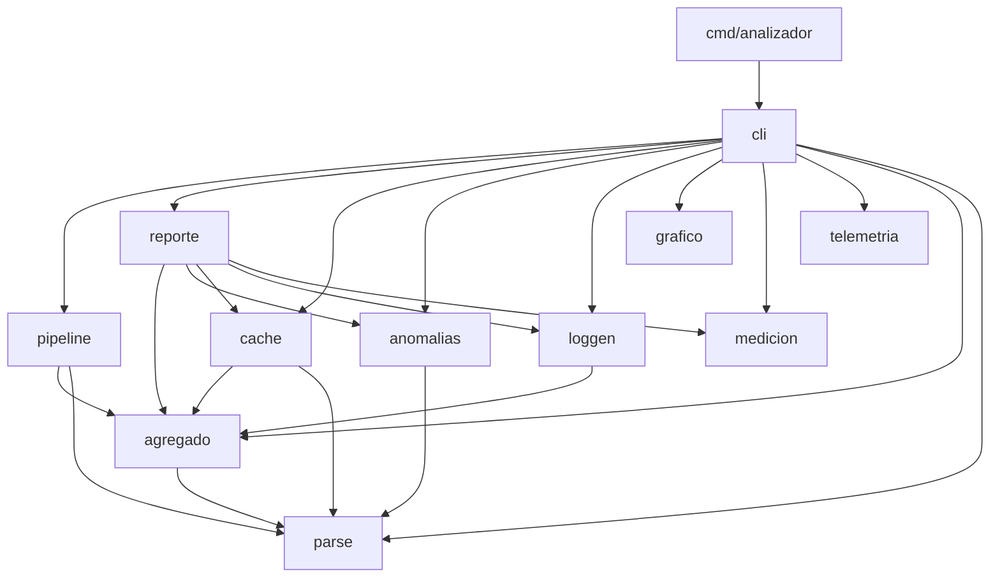
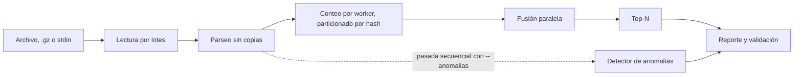

# Arquitectura

El proyecto es un único binario, `analizador`, con subcomandos. `cmd/analizador` no tiene lógica: crea el contexto cancelable con Ctrl+C, llama a `internal/cli` y traduce el error a un código de salida.

## Diagrama de componentes

Las flechas son las importaciones reales entre paquetes, obtenidas con `go list` (sin contar los tests).

## Módulos y responsabilidades

| Paquete | Responsabilidad |
|---|---|
| `cmd/analizador` | Punto de entrada y códigos de salida; incluye `default.pgo`, el perfil para PGO |
| `internal/cli` | Comandos Cobra `generar`, `analizar` y `grafico`; validación de flags |
| `internal/parse` | Parseo de líneas: regex (referencia) y manual (el que se usa) |
| `internal/pipeline` | Lectura por lotes y modos secuencial, map-reduce, con mutex y productor-consumidor |
| `internal/agregado` | `Contador`, fusión paralela particionada y Top-N (sort y min-heap) |
| `internal/anomalias` | Ventanas deslizantes, picos de 5xx con estacionalidad y escaneos |
| `internal/cache` | Memoización de agregados en disco y cache de consultas |
| `internal/reporte` | Presentación, validación contra el *ground truth* y CSV de mediciones |
| `internal/loggen` | Generador sintético: Poisson no homogéneo, Zipf y anomalías inyectadas |
| `internal/medicion` | Tiempo y memoria de una operación |
| `internal/grafico` | Curva de escalabilidad en SVG |
| `internal/telemetria` | Trazas OpenTelemetry por OTLP |

## Flujo de un análisis

- Un archivo común se reparte en bloques por offset, y cada worker lee el suyo.
- Un `.gz` o `stdin` no se puede partir por offset: un lector corta lotes y N workers los parsean (productor-consumidor).
- El detector de anomalías necesita orden temporal, por lo que hace una pasada secuencial aparte.

## Dependencias externas

| Dependencia | Usada en | Para qué |
|---|---|---|
| `github.com/spf13/cobra` | `cli` | Framework de CLI |
| `go.opentelemetry.io/otel` y exportador OTLP | `telemetria`, `cli`, `pipeline` | Trazas |

Ninguna está en el camino caliente: el parseo, el conteo y el Top-N usan solo la biblioteca estándar. Las versiones están fijadas en `go.mod` y `go.sum`.

**Jaeger** (`docker-compose.yml`) es opcional y solo sirve para ver las trazas.
