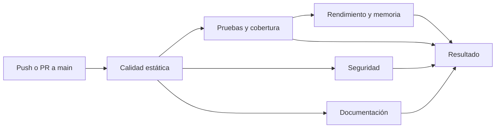

# Mantenimiento

## Cómo contribuir

1. Crear una rama desde `main`.
2. Hacer el cambio junto con sus tests. Si cambia el comportamiento o un contrato, actualizar también estas páginas.
3. Si cambió el código de `internal/`, regenerar la API (incluye comentarios y números de línea):

    ```bash
    go run github.com/princjef/gomarkdoc/cmd/gomarkdoc@v1.1.0 --output 'docs/api/{{.Dir}}.md' ./internal/...
    ```

4. Ejecutar `scripts/controles.sh todo`.
5. Abrir un PR hacia `main`. Para integrarlo hace falta el check **Resultado** en verde. No se exige una aprobación, así que cada integrante puede integrar sus propios PR, pero nadie puede hacerlo con el check en rojo: la regla también se aplica a los administradores.

Si un cambio toca el camino caliente, conviene regenerar `cmd/analizador/default.pgo` (ver [`SEGUNDO-PARCIAL.md`](https://github.com/mordecoi/analizador-logs-go/blob/main/SEGUNDO-PARCIAL.md), sección 2).

## Matriz de controles

| Control | Herramienta | Etapa | Reporte | Se rechaza si |
|---|---|---|---|---|
| Pruebas | `go test -race` | `pruebas` | `pruebas.txt` | Falla una prueba o hay una carrera |
| Cobertura | `go test -coverprofile` | `pruebas` | `cobertura.html`, `cobertura.txt` | El total baja de 85 % |
| Análisis estático | `golangci-lint` (21 linters) | `estatico` | `lint.txt` | Hay algún hallazgo |
| Complejidad | `gocyclo`, `gocognit`, `funlen` | `estatico` | `lint.txt`, `complejidad.txt` | Ciclomática > 15, cognitiva > 20, o función de más de 70 líneas o 45 sentencias |
| Tipado estático | `go build`, `go vet` | `estatico` | Registro del job | Hay un error de compilación o de `vet` |
| Dependencias fijadas | `go mod tidy -diff`, `go mod verify` | `estatico` | Registro del job | `go.mod` o `go.sum` están desordenados o alterados |
| Vulnerabilidades del código | `gosec`, CodeQL | `seguridad` | `gosec.txt`, `gosec.sarif` | [Ver política](seguridad.md#politica-de-bloqueo) |
| Vulnerabilidades de dependencias | `govulncheck`, Dependabot | `seguridad` | `govulncheck.txt`, `govulncheck.sarif` | Hay una vulnerabilidad alcanzable |
| Secretos | `gitleaks` | `seguridad` | `gitleaks.sarif` | Hay un hallazgo no documentado |
| Documentación | `mkdocs --strict`, `markdownlint-cli2`, Lychee, `gomarkdoc` | `docs` | `enlaces.md` | Falla la construcción, el formato o un enlace, o la API generada está desactualizada |
| Benchmark | `go test -bench`, `benchstat` | `rendimiento` | `benchstat.txt`, `benchstat.csv` | Tiempo +20 % o asignaciones +5 %, con p < 0,05 |
| Profiling de CPU | `pprof` | `rendimiento` | `perfil-cpu.txt`, `cpu.pprof` | No rechaza; es informativo |
| Memoria | `pprof`, CSV del analizador | `rendimiento` | `perfil-memoria.txt`, `rendimiento.csv` | Se supera un [límite medido](rendimiento.md#controles-en-el-ci) |

**Sobre el tipado.** Go tiene tipado estático, así que el compilador cumple el papel de mypy o Pyright, y `go vet` agrega comprobaciones que el compilador no hace. No hace falta otra herramienta.

**Sobre el umbral de cobertura.** El 85 % deja margen para el trabajo normal sobre el 92,6 % actual, pero impide que la cobertura caiga sin que se note.

## Etapas del pipeline



Primero corre lo más rápido. Las etapas sin dependencias entre sí corren en paralelo, y las mediciones costosas quedan al final. Cada etapa instala las mismas versiones: Go desde `go.mod`, módulos verificados por `go.sum`, herramientas fijadas en `scripts/controles.sh` y dependencias de Python en `docs/requirements.txt`.

**Resultado** falla si alguna etapa no aprobó, y es el check que exige la protección de `main`.

## Ejecutar los controles localmente

El CI ejecuta `scripts/controles.sh`, así que localmente se corren **exactamente los mismos controles**. En Windows, usar Git Bash.

```bash
scripts/controles.sh estatico     # go.mod, compilación, vet, lint, complejidad
scripts/controles.sh pruebas      # tests, carreras, cobertura
scripts/controles.sh seguridad    # gosec, govulncheck, gitleaks
scripts/controles.sh docs         # sitio, API generada, markdownlint, enlaces
scripts/controles.sh rendimiento  # benchmarks, perfiles, memoria
scripts/controles.sh todo
```

Solo con Go alcanza para `estatico`, `pruebas`, `seguridad` y `rendimiento`, porque las herramientas se descargan solas en la versión fijada. Para `docs` hace falta además:

```bash
# Python 3.13 (el del CI) o 3.14: PyYAML no se pudo instalar en 3.15
python -m pip install -r docs/requirements.txt  # MkDocs y sus extensiones
# Node.js, para npx markdownlint-cli2
# lychee en el PATH: https://github.com/lycheeverse/lychee/releases/tag/lychee-v0.24.2
```

CodeQL y Dependabot solo corren en GitHub.

Diferencias que hay que tener en cuenta:

- **Detector de carreras:** en Windows no se ejecuta. Bitdefender bloqueó `pipeline.test.exe` compilado con `-race` (`Gen:Variant.Togi.101644`, una detección genérica y probablemente un falso positivo), y Go lo informa como `Access is denied`. El script avisa y corre los tests sin `-race`. El CI, en Linux, siempre lo usa, y [se puede reproducir con Docker](#resolver-fallos-del-pipeline).
- **Rendimiento:** localmente compara contra el punto donde la rama se separó de `main`. Se puede cambiar con `BASE_REF=<commit>`. Los límites de memoria se fijaron con mediciones del runner, y pueden variar un poco en otra máquina.
- **Versión de Go:** el CI usa la de `go.mod`. Con una versión de Go más nueva, `govulncheck` analiza otra biblioteca estándar y puede dar otro resultado. Para reproducirlo: `GOTOOLCHAIN=go1.26.10 scripts/controles.sh seguridad`.

## Evidencia de rechazo

Cada PR de prueba rompió un solo control a propósito y se cerró sin integrar. El check **Resultado** falló en todos. Los enlaces llevan a la ejecución del pipeline.

| PR | Qué rompe | Etapa que rechazó | Motivo informado | Ejecución |
|---|---|---|---|---|
| [#2](https://github.com/mordecoi/analizador-logs-go/pull/2) | Una prueba que falla | Pruebas y cobertura | `--- FAIL: TestFallaAProposito` | [Ver](https://github.com/mordecoi/analizador-logs-go/actions/runs/41396339594) |
| [#3](https://github.com/mordecoi/analizador-logs-go/pull/3) | Una función sin usar | Calidad estática | `func sinUso is unused` | [Ver](https://github.com/mordecoi/analizador-logs-go/actions/runs/41396342937) |
| [#4](https://github.com/mordecoi/analizador-logs-go/pull/4) | Borra los tests de la CLI | Pruebas y cobertura, y Documentación | `cobertura total: 75.8 % (mínimo: 85 %)`; además, un documento enlazaba ese archivo | [Ver](https://github.com/mordecoi/analizador-logs-go/actions/runs/41396345577) |
| [#5](https://github.com/mordecoi/analizador-logs-go/pull/5) | Un secreto inventado | Seguridad | `leaks found: 1` | [Ver](https://github.com/mordecoi/analizador-logs-go/actions/runs/41396350580) |
| [#6](https://github.com/mordecoi/analizador-logs-go/pull/6) | Un enlace roto | Documentación | `docs/no-existe.md: File not found` | [Ver](https://github.com/mordecoi/analizador-logs-go/actions/runs/41396354607) |
| [#7](https://github.com/mordecoi/analizador-logs-go/pull/7) | Una copia por línea en el parser | Rendimiento y memoria | `Parsear/manual sec/op +44.15%`; `memoria asignada: 279.5 MB (máximo: 82)` | [Ver](https://github.com/mordecoi/analizador-logs-go/actions/runs/41396380575) |

Con la protección de `main` activa, GitHub informó el PR #7 como `BLOCKED`, por su check **Resultado** en rojo: no se puede integrar.

Estas pruebas también encontraron fallas del propio pipeline, ya corregidas:

| Falla | Corrección |
|---|---|
| `gitleaks` revisaba todas las ramas: el secreto de una rama hacía fallar el CI de las demás, incluida `main` | Revisa solo el historial de la versión probada |
| Un `504` temporal de GitHub rechazó un PR sin relación | Los errores temporales no rechazan, y los enlaces generados de `docs/api` no se revisan |
| Pasar de 0 asignaciones a alguna no se detectaba por sí solo: `benchstat` no da un porcentaje si la base es 0 | La comparación cubre ese caso. La ejecución de #7 es anterior a esta corrección y su regresión se detectó por otras métricas |

## Reportes

Localmente quedan en `reportes/`, que no se versiona. En GitHub se descargan desde la ejecución del pipeline, en la sección **Artifacts**, con un artefacto por etapa. Los SARIF de `gosec` y `gitleaks` también aparecen en la pestaña **Security**, en *Code scanning*.

## Resolver fallos del pipeline

| Etapa y síntoma | Causa probable | Solución |
|---|---|---|
| `estatico`: `go mod tidy -diff` muestra diferencias | Cambió un import sin ordenar el módulo | `go mod tidy` y commit |
| `estatico`: hallazgo de `golangci-lint` | Formato, error sin chequear, complejidad | Corregirlo. Para formato: `golangci-lint fmt`. Si es falso positivo, usar `//nolint:<linter> // motivo` |
| `pruebas`: falla solo en CI | Diferencia entre Linux y Windows, o una carrera con `-race` | Reproducir en Linux: ver el comando abajo |
| `pruebas`: cobertura debajo del mínimo | Código nuevo sin tests | Agregar tests; ver `reportes/cobertura.html`. No bajar el umbral para aprobar |
| `seguridad`: `govulncheck` | Dependencia o versión de Go vulnerable | `go get <módulo>@<versión corregida>` y `go mod tidy`, o subir la versión de Go en `go.mod`. Registrarlo en [Seguridad](seguridad.md#medidas-correctivas) |
| `seguridad`: `gosec` | Patrón inseguro de severidad alta | Corregirlo. Si es falso positivo, documentarlo en [Seguridad](seguridad.md#excepciones-y-falsos-positivos) |
| `seguridad`: `gitleaks` | Secreto en el historial | Rotar la credencial **antes** de limpiar el historial. Si es falso positivo, usar un `.gitleaks.toml` y documentarlo |
| `docs`: `mkdocs --strict` | Enlace interno roto o página fuera del `nav` | Corregir el enlace o agregar la página a `mkdocs.yml` |
| `docs`: `docs/api está desactualizada` | Cambió el código de `internal/` sin regenerar la API | Regenerarla (paso 3 de arriba) |
| `docs`: enlace roto | Enlace externo caído o archivo movido | Corregirlo. Si es caída temporal, volver a ejecutar el job |
| `rendimiento`: regresión | Código más lento o con más asignaciones | Leer `benchstat.txt` y `perfil-cpu.txt`. Si la regresión es un costo aceptado, justificarlo en el PR |
| `rendimiento`: límite de memoria | Más heap o más asignaciones | Comparar `perfil-memoria.txt`. Solo se cambia el límite con una medición nueva y su justificación en [Rendimiento](rendimiento.md) |
| `rendimiento`: código de salida 2 | El análisis dejó de coincidir con el *ground truth* | Es un error de correctitud, no de rendimiento: ver `analisis.txt` |
| `rendimiento`: regresión de tiempo aislada | Ruido del runner | Volver a ejecutar el job una vez. Si se repite, es real |
| Una etapa aparece como `skipped` | Falló una etapa de la que depende | Resolver primero la anterior |

Para reproducir en Linux desde Windows, con Docker:

```bash
docker run --rm -v "$PWD":/src -w /src golang:1.26.10 go test -race ./...
```
